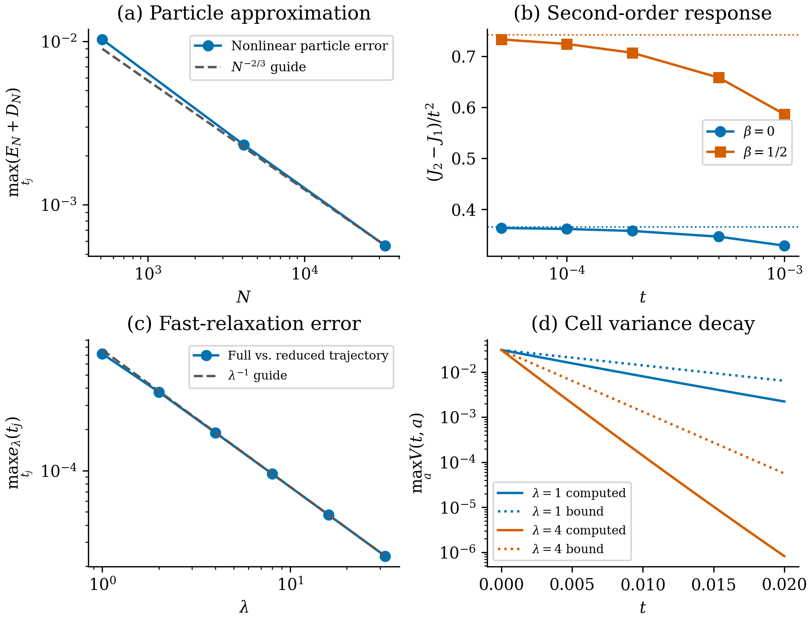
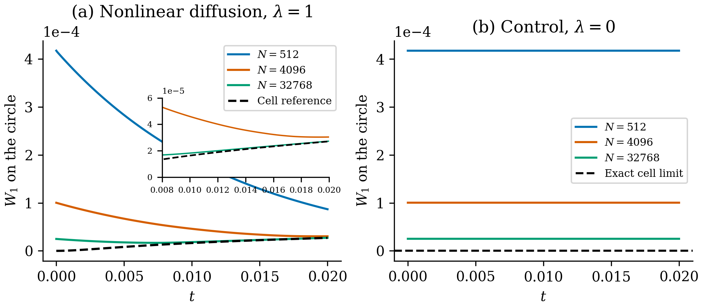

# Gap arrangement in nonlocal particle transport

This repository contains Python simulations for *Gap arrangement and quantitative nonclosure in nonlinear nonlocal particle transport* by Georgia Karali and Vangelis D. Karalis.

The research investigates how the spatial arrangement of microscopic interparticle gaps affects the time evolution and macroscopic dynamics of nonlocally interacting particle systems.
A central result is that systems with identical initial particle densities, gap-value distributions, and macroscopic velocities can nevertheless develop different macroscopic dynamics due to differences in their microscopic gap arrangements.

The numerical experiments examine:

- **Second-order dynamical separation:** Verification of quadratic-in-time macroscopic separation measured by the Wasserstein-1 distance.
- **Diffusion-dependent dynamics:** Exact gap-law closure at zero diffusion and approximate mean-cell dynamics under fast diffusion.
- **Particle-to-continuum dynamics:** Quantitative convergence of discrete particle trajectories to a coupled macroscopic–microscopic evolution.
- **Arrangement-dependent dynamics:** How microscopic gap organization influences collective motion and macroscopic acceleration.
- **Dynamical nonclosure:** Why complete gap-value distributions may be insufficient to predict macroscopic evolution under positive cell diffusion.
- **Numerical reproducibility:** Independent computational checks of convergence rates, dynamical predictions, and reduced-model accuracy.

The mathematical model, initial data and numerical methods are specified in this
repository. The associated manuscript has not yet been submitted; no journal
publication or article DOI is claimed. The citation below identifies the software.

**Code creator:** Vangelis D. Karalis · **Software version:** 1.0.0 · **License:** MIT

**Study contributor:** Georgia Karali — Department of Mathematics, National and
Kapodistrian University of Athens.

## Manuscript figures and tables

The manuscript contains **five figures and five tables**. This GitHub release
(v1.0.0) reproduces Figures 1–2 and Tables 1–2. The manuscript's separate
computational supplement, `GAD_Reproducibility_Rephrased.zip` (2026-11-02-r5),
contains the additional experiments for Figures 3–5 and Tables 3–5.

| Manuscript item | Experiment | Where to reproduce it |
| --- | --- | --- |
| Figure 1 and Tables 1–2 | Particle approximation, small-time response and fast relaxation | GitHub v1.0.0, `python -m gap_arrangement reproduce` |
| Figure 2 | Circular Wasserstein distance with positive and zero diffusion | Same GitHub command |
| Figures 3–4 and Table 3 | Frequency sweep, mesh and diffusivity checks, observation times and invariant diagnostics | Supplement, `simulations/extended_checks.py` |
| Figure 5 and Table 4 | Nonlinear diffusion strength, contrast and harmonic generation | Supplement, `simulations/nonlinearity_checks.py` |
| Table 5 | Small-time circular Wasserstein distance and separate refinement checks | Supplement, `simulations/wasserstein_checks.py` |

**The file cited on page 37** is `simulations/wasserstein_results.json` inside
the supplement's `GAD_Rephrased_Reproducibility/` directory. It contains the
four Table 5 rows, both initial-data quadratures, and the changes under separate
refinements of quadrature order, time step, macroscopic grid and cell grid.
To regenerate the supplement's results, extract the ZIP, enter that directory,
install `requirements.lock` in a Python 3.12.14 environment and run
`python reproduce.py` there.

## Install

This release supports **Python 3.12 only** (`>=3.12,<3.13`). The package metadata,
source runner, `.python-version` and CI all use this same restriction. From the
repository directory:

```bash
python -m venv .venv
```

Activate the environment on macOS/Linux:

```bash
source .venv/bin/activate
```

Or in Windows PowerShell:

```powershell
.venv\Scripts\Activate.ps1
```

Then install the exact runtime/build dependencies and the package:

```bash
python -m pip install -r requirements-lock.txt -r requirements-build.txt
python -m pip install --no-build-isolation --no-deps .
```

Alternatively, install only the dependencies with
`python -m pip install -r requirements-lock.txt` and use `python reproduce.py` instead
of `python -m gap_arrangement`. Both entry points call the same implementation.

## Reproduce the GitHub v1.0.0 results

Run from the repository root:

```bash
python -m gap_arrangement reproduce
```

This checks the bundled synthetic inputs and executes the independent audit,
the main simulations, the supplementary affine experiment, the exact rational certificate, and comparison with the frozen
reference results. Allow several minutes on a recent laptop; runtime varies by
hardware. Peak memory can approach 1 GB. The simulation itself runs offline after
installation. A nonzero exit status indicates a failed check or execution error.

The GitHub command writes the following files under `outputs/`.

| Directory/file | Contents |
| --- | --- |
| `data/input_verification.json` | Agreement of regenerated initial conditions with the supplied inputs |
| `data/simulation_results.json`, `data/simulation_curves.npz` | Main results and time series |
| `data/audit_results.json`, `data/audit_curves.npz` | Independent checks and relaxation curves |
| `data/sanity_results.json` | Supplementary affine experiment |
| `data/certificate.json` | Exact rational observation-time bound for the affine example |
| `data/verification.json` | Numerical comparison with the original results |
| `figures/` | Figures 1 and 2, each as PDF and PNG |
| `tables/` | Tables 1 and 2 as LaTeX and full-precision CSV, plus theoretical coefficients |
| `run_manifest.json` | Command status, actual environment, timestamps and SHA-256 hashes |

`inputs/` contains the synthetic initial conditions and full experiment settings.
`reference/` contains frozen numerical results and is protected
against use as an output directory. `outputs/` is ignored by Git. Reusing an output
directory overwrites the corresponding generated files; use `--output-dir` to
retain separate runs.

## Reproduce v1.0.0 in a clean environment

With Python 3.12, run from the repository directory:

```bash
python scripts/clean_reproduce.py --work-dir clean-run
```

The destination must not exist. This command creates a new virtual environment
with system packages disabled, downloads the pinned dependencies from PyPI
without using a pip cache, builds and installs the package, checks dependency
consistency and isolation, runs the tests, and recomputes the v1.0.0 simulations from
outside the source directory using isolated Python (`-I`). It records the
environment and results in `clean-run/clean_reproduction.json`. Network access
is needed for installation; the numerical run itself uses only supplied data.

The test suite covers the numerical methods, all 40 synthetic input arrays,
command-line behavior and exported files. The full pipeline also compares the
two curve archives with the supplied reference values and validates CSV values,
PNG pixels and PDF content. GitHub-hosted runs are available under
[Actions](https://github.com/vkaralis/gap-arrangement-dynamics/actions).

## Synthetic inputs

All initial conditions are analytic and synthetic. The included
`inputs/initial_conditions.npz` contains the numerical preparations, while
`inputs/experiment.json` records the equations, parameters and solver settings.
The solvers regenerate these preparations internally and verify agreement with
the supplied snapshots before the full run. No unavailable dataset is required.
See [the input schema](inputs/README.md).

```bash
python -m gap_arrangement synthetic --output-dir generated
python -m gap_arrangement check-inputs --inputs-dir generated/inputs --output-dir input-check
```

## Other commands

```bash
python -m unittest discover -s tests -v
python -m gap_arrangement validate
python -m gap_arrangement simulate
python -m gap_arrangement affine
python -m gap_arrangement certificate
python -m gap_arrangement verify
```

`simulate` needs the audit files generated by `validate` in the same output
directory. `verify` expects all outputs from a complete run and checks numerical
values, CSV contents and both figures against a fresh rendering of the saved
data. Run it in the same rendering environment, or regenerate the figures first. The certificate
command uses only Python's standard library and can also be run directly as
`python reproduce.py certificate` without installing dependencies.

To regenerate figures and tables from the supplied reference data without
integrating the equations:

```bash
python -m gap_arrangement figures --input-dir reference --output-dir outputs
```

For execution from another directory, provide paths explicitly:

```bash
python -m gap_arrangement reproduce --reference-dir /path/to/repository/reference --inputs-dir /path/to/repository/inputs --output-dir /path/to/new-results
```

The installed `gap-arrangement` console command is an equivalent entry point.
Do not use `python -O` or set `PYTHONOPTIMIZE`: this would disable scientific
assertions, so the command-line interface rejects that mode.

## Expected results

| Quantity | Reference value |
| --- | ---: |
| Nonlinear theoretical `C2/2` | 0.741984411175 |
| Affine theoretical `C2/2` | 0.365253559927 |
| Nonlinear cell `W1(T)`, `T = 0.02` | 2.7102359 × 10⁻⁵ |
| Particle errors for `N = 512, 4096, 32768` | 0.0102769, 0.00233002, 0.000562716 |
| Early-time nonlinear observable coefficient at `t = 5e-6` | approximately 0.741078 |
| Relaxation trajectory error at `lambda = 32` | approximately 2.37289 × 10⁻⁵ |

The computed scalings agree with the theoretical predictions in the tested
regimes. Numerical mesh maxima and refinement checks are not rigorous suprema or
interval proofs. The rational time certificate concerns a separate affine
theoretical example, not the full simulation horizon `T = 0.02`. Potential uses
in traffic, collective migration, and confined particle flow require
model-specific development and validation; these experiments do not simulate
those application systems.





## Methods, software and citation

- [Equations, parameters and numerical methods](docs/NUMERICAL_METHODS.md)
- [Validation, tolerances and software provenance](docs/REPRODUCIBILITY.md)
- [Repository policy](CONTRIBUTING.md)
- [Changelog and release version](CHANGELOG.md)

The numerical stack is NumPy 2.3.5, SciPy 1.17.1 and Matplotlib 3.10.9.
Pillow 12.3.0 is used for figure export and pixel verification. Runtime requirements are
recorded in the dependency files. Machine-specific run records are generated
locally under ignored output directories.

Please cite version 1.0.0 of the software using [CITATION.cff](CITATION.cff).
A DOI has not been assigned. This repository is distributed under the
[MIT license](LICENSE).

## Public-file cleanup

The upload contains source, synthetic inputs, scientific reference results,
documentation and tests. Figures omit embedded authoring metadata; reference
JSON omits machine inventories and execution timings. Local run manifests and
logs remain in ignored output directories. Git history, duplicate bundles and
intermediate files are excluded from the published source.

## Repository policy

This repository is provided for reproducibility and reuse. External contributions,
support requests and discussions are not accepted. Issues, pull requests and
discussions are disabled. Version 1.0.0 is archived after successful GitHub Actions
verification, making the repository read-only, including comments. The owner
must unarchive it before publishing future changes.

## Repository topics

`gap-arrangement-dynamics`, `particle-dynamics`, `interacting-particle-systems`,
`gap-diffusion`, `two-scale-modeling`, `nonlinear-diffusion`,
`wasserstein-distance`, `scientific-computing`, `mathematical-modeling`.

These topics are recorded in `topics.txt`, package keywords and citation metadata.
